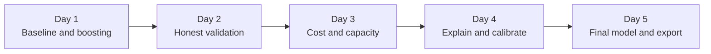
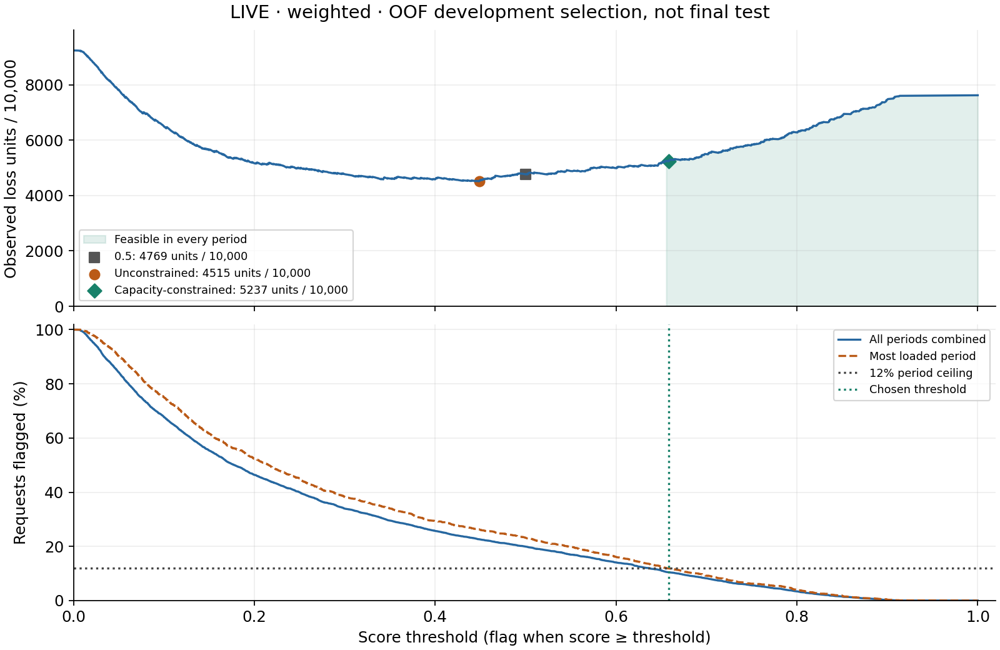
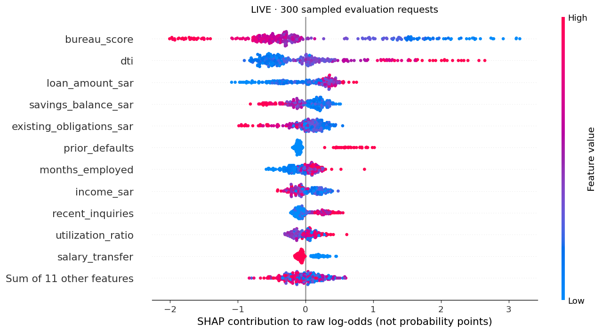
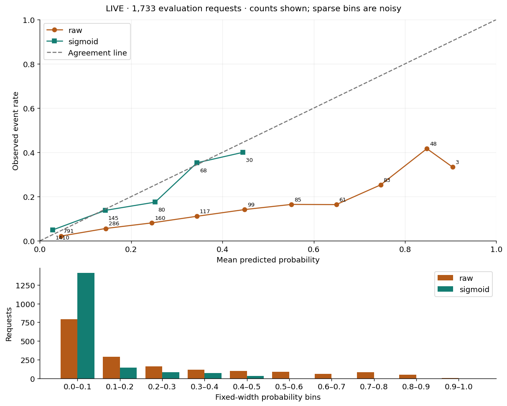
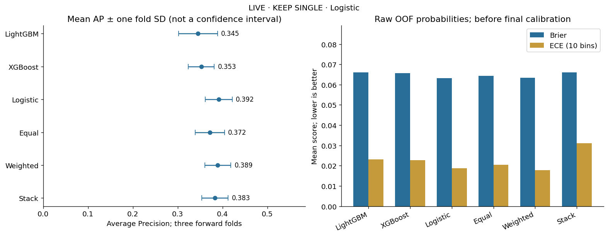

<div align="center">

# Tamweel Lite
### Explainable credit-risk screening, built in five daily labs

**أساليب تعلم الآلة المتقدمة · SDA-DSC-211 · Advanced Machine Learning Methods**


[Results](#results-at-a-glance) · [Journey](#the-five-day-journey) · [Figures](#figures) · [Daily answers](#daily-answers--الإجابات-اليومية) · [Run it](#run-it-yourself) · [Limits](#limitations-and-responsible-use) · [Credits](#credits-and-sdaia-reference)

</div>

---

## About the project

Built for the SDAIA (سدايا) course *Advanced Machine Learning Methods*.

Tamweel Lite predicts whether a loan applicant will default **within 90 days of applying**, using only information known at application time. Each day adds one layer: compare models, validate honestly, decide with costs and capacity, explain and calibrate, then export one final model.

> **Everything here is a training exercise on fictional, synthetic data.** It must not be used for real lending or credit decisions.



## Results at a glance

| | |
|---|---|
| **Final model** | Logistic Regression (a single model; no ensemble passed the gate) |
| **Mean Average Precision** | 0.392 (fold SD 0.030) |
| **Brier / ECE** | 0.0633 / 0.0188 |
| **Decision threshold** | 0.169 (out-of-fold, chosen with a 10:1 miss-to-false-alarm cost) |
| **Review load** | 11.4% flagged against a 12% capacity limit |
| **Challenge batch** | 300 of 2,500 requests flagged (330 were eligible, 30 removed by the cap) |
| **Setup** | seed 211 · 80 trees · free CPU · Google Colab |

## The five-day journey

| Day | Lab | What I did | Key result |
|:--:|---|---|---|
| 1 | [Baseline and boosting](notebooks/01_baseline_boosting.ipynb) | Compared Logistic Regression, XGBoost and LightGBM | Logistic Regression: ROC-AUC 0.821, AP 0.326 |
| 2 | [Honest validation](notebooks/02_validation_tuning.ipynb) | Removed leaky fields, forward time splits, small search | Leaky ROC-AUC 0.9999 vs about 0.80 once removed |
| 3 | [Cost-sensitive decision](notebooks/03_cost_sensitive_decision.ipynb) | Threshold under cost and 12% review capacity | Threshold 0.6583 instead of 0.5 |
| 4 | [Explain and calibrate](notebooks/04_explain_calibrate.ipynb) | Permutation importance, SHAP, sigmoid calibration | `bureau_score` first; Brier 0.1130 to 0.0671 |
| 5 | [Final model](notebooks/05_final_model.ipynb) | Compared single models and ensembles, exported the project | Kept the single model |

### Final model comparison (Day 5)

| Candidate | Mean AP | Fold SD | Brier | ECE | Passes gate |
|---|:--:|:--:|:--:|:--:|:--:|
| **Logistic Regression** | **0.392** | 0.030 | **0.0633** | 0.0188 | chosen |
| Weighted average | 0.389 | 0.029 | 0.0633 | **0.0177** | no |
| Stacking | 0.383 | 0.030 | 0.0660 | 0.0311 | no |
| Equal average | 0.372 | 0.033 | 0.0643 | 0.0204 | no |
| XGBoost | 0.353 | 0.029 | 0.0657 | 0.0228 | no |
| LightGBM | 0.346 | 0.044 | 0.0661 | 0.0231 | no |

## Figures

<table>
  <tr>
    <td align="center"><br><sub>Day 1 · ROC and precision-recall</sub></td>
    <td align="center"><br><sub>Day 2 · leaky vs honest validation</sub></td>
    <td align="center"><br><sub>Day 3 · cost curve</sub></td>
  </tr>
  <tr>
    <td align="center"><br><sub>Day 4 · SHAP summary</sub></td>
    <td align="center"><br><sub>Day 4 · calibration</sub></td>
    <td align="center"><br><sub>Day 5 · ensemble comparison</sub></td>
  </tr>
</table>

## Daily answers | الإجابات اليومية

### Day 1 | اليوم 1

**Which model did you select initially, and what is the strongest result supporting your choice?**

I chose **Logistic Regression**. It had the best ROC-AUC (0.821, versus 0.812 for XGBoost and 0.814 for LightGBM), almost the same Average Precision (0.326 versus 0.334), and the fastest training time (0.025 s). This was one random split, so it is only a starting point.

### Day 2 | اليوم 2

**What leakage risk did you identify, and how did the validation design prevent it?**

I found two leaky columns, `days_past_due_60` and `collection_calls`, which are recorded after the application. With them the ROC-AUC was 0.9999; after removing them it was about 0.80. I prevented leakage by dropping them, using forward time splits with no shared customers, and fitting the imputer on training rows only.

### Day 3 | اليوم 3

**Why is a fixed threshold of 0.5 not always suitable for this review policy?**

A 0.5 threshold ignores unequal costs and limited review capacity. At 0.5 the model flagged 19.9% of cases, over the 12% limit. I used 0.6583, which keeps flags within capacity in every period, and accepted a higher loss (2,639 units versus 2,275 without a limit).

### Day 4 | اليوم 4

**Which feature was most important in your explanation, and why does that not prove causality?**

The most important feature was `bureau_score`, followed by `dti`. This shows what the weighted LightGBM model relies on, not what causes default, so it does not prove causation. Sigmoid calibration also lowered Brier from 0.1130 to 0.0671.

### Day 5 | اليوم 5

**Why did you choose the single model or the ensemble for the final project?**

I kept a single model, Logistic Regression. It had the highest mean AP (0.392) and the lowest Brier and ECE among the strongest candidates, and no ensemble passed the improvement gate.

## Run it yourself

Free Google Colab (CPU) is enough. Open a notebook, then choose **Runtime → Run all**.

| Day | Open in Colab |
|:--:|---|
| 1 | [](https://colab.research.google.com/github/Allhabiy/SA-AMLM-project/blob/main/notebooks/01_baseline_boosting.ipynb) |
| 2 | [](https://colab.research.google.com/github/Allhabiy/SA-AMLM-project/blob/main/notebooks/02_validation_tuning.ipynb) |
| 3 | [](https://colab.research.google.com/github/Allhabiy/SA-AMLM-project/blob/main/notebooks/03_cost_sensitive_decision.ipynb) |
| 4 | [](https://colab.research.google.com/github/Allhabiy/SA-AMLM-project/blob/main/notebooks/04_explain_calibrate.ipynb) |
| 5 | [](https://colab.research.google.com/github/Allhabiy/SA-AMLM-project/blob/main/notebooks/05_final_model.ipynb) |
| Check | [](https://colab.research.google.com/github/Allhabiy/SA-AMLM-project/blob/main/notebooks/99_final_submission_check.ipynb) |

To score new requests with the saved model, use `tamweel/inference.py` (`predict` returns the request ID and a calibrated probability). `scripts/replay_final.py` reproduces the saved predictions and `scripts/rebuild_final.py` retrains the model.

### Repository layout

```text
├── notebooks/            executed notebooks 01–05, plus the 99 self-check
├── artifacts/
│   ├── Day1 … Day4/      files generated by each lab
│   └── Day5/             final model, policy, reports/ and submission/
├── data/                 synthetic training and challenge data, data contract
├── scripts/              replay and rebuild scripts
├── tamweel/              inference package
├── requirements-colab.txt
└── constraints.txt
```

Key outputs: [`submission.csv`](artifacts/Day5/submission/submission.csv) · [Model card](artifacts/Day5/reports/MODEL_CARD.md) · [Ensemble decision](artifacts/Day5/reports/ENSEMBLE_DECISION.md)

## Limitations and responsible use

- The data is synthetic, so no result describes real people, regions or lenders.
- Validation uses three forward folds, so the AP spread (about 0.03) is as large as the gaps between candidates.
- Calibration used only 836 rows with 78 defaults, and its plot is a fit diagnostic, not an independent test.
- Day 4 explanations describe the Day 4 LightGBM model, not the final Logistic Regression model.
- False positive rates differ by region (6.3% eastern to 10.3% western), so western applicants get more false alarms.
- A flag is only a simulated review signal, never an approval or refusal. The 10:1 cost and 12% capacity are assumptions.
- No passwords, tokens, API keys or personal data are stored in this repository.

## Credits and SDAIA reference

This project was completed as part of **Advanced Machine Learning Methods (SDA-DSC-211)**, a training course of the **Saudi Data and Artificial Intelligence Authority (SDAIA | سدايا)**. Under the course rules, attendance plus a project score of 70 or more earns an SDAIA completion certificate.

- Course material prepared and delivered by **Meaad Al-Marri | ميعاد المري**: [course portal](https://almiyead-rgb.github.io/advanced-machine-learning-methods-sda-dsc-211/) · [student template](https://github.com/almiyead-rgb/sda-dsc-211-student-template)
- SDAIA: [sdaia.gov.sa](https://sdaia.gov.sa)
- Libraries: scikit-learn, XGBoost, LightGBM, Optuna, SHAP

> This is a student repository. It is **not an official SDAIA account** and is not endorsed by SDAIA. Third-party tools keep their own licences.
